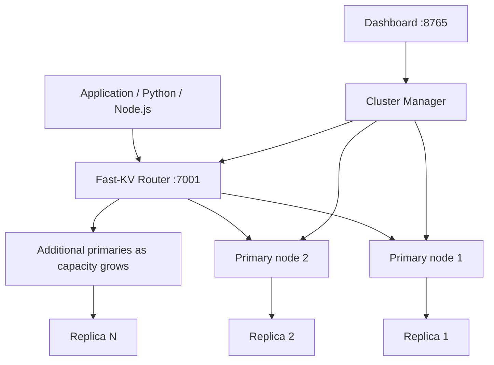

# Fast-KV

**Distributed in-memory caching engine in modern C++.**

Fast-KV provides fast key-value access, expiration policies, bounded memory usage, automatic cluster scale-out, replica failover, and persistence through a single router endpoint. It includes a browser-based control plane and SDKs for Python and Node.js.

## Highlights

| Capability | What it provides |
| --- | --- |
| In-memory cache | `SET`, `GET`, `DEL`, `EXISTS`, `INCR` and other key-value operations |
| Key expiration | Per-key TTL, database-wide default lifetime, and permanent keys |
| Bounded memory | Configurable node capacities, custom slab allocator and LRU eviction |
| Scale-out | Adds storage nodes when configurable utilization thresholds are crossed |
| Replication & failover | Primary/replica topology with automatic promotion during tested primary failures |
| Persistence | Append-only storage and restart recovery |
| Developer experience | One-command startup, terminal CLI, Python and Node.js SDKs |
| Control plane | Node health, live request metrics, cluster settings, key browser, and backup/restore |

## Architecture



The router provides a stable endpoint while the cluster manager supervises storage nodes, scaling decisions, and primary recovery.

## Quick start

**Requirements:** macOS or Linux, CMake 3.20+, a C++20 compiler, and Python 3.9+.

```bash
# From the repository root
bash scripts/install_local.sh
~/.local/bin/fastkv start
~/.local/bin/fastkv status
```

Open the dashboard with `~/.local/bin/fastkv dashboard`, or visit `http://127.0.0.1:8765`.

The standard router endpoint is `127.0.0.1:7001`. To choose cache capacity and scale-out settings:

```bash
~/.local/bin/fastkv start --capacity-mb 128 --max-nodes 3 --threshold 70 --replicas 1
```

For shutdown:

```bash
~/.local/bin/fastkv stop
~/.local/bin/fastkv shutdown
```

## Python example

```bash
python3 -m venv .venv
source .venv/bin/activate
python -m pip install --no-cache-dir ./sdk/python
```

```python
from fastkv import FastKV

cache = FastKV(port=7001)
cache.set("session:42", "active", ttl=1800)
print(cache.get("session:42"))

cache.set("page:views", 0)
cache.incr("page:views")
print(cache.get("page:views"))
```

## Node.js example

From the repository root:

```js
const { FastKV } = require('./sdk/node');

async function main() {
  const cache = new FastKV();
  await cache.set('product:42', 'cached', { ttl: 300 });
  console.log(await cache.get('product:42'));
}
main().catch(console.error);
```

## Dashboard

The dashboard groups the main workflows in this order:

1. **Cluster Overview & Monitoring** — throughput, latency, and node health.
2. **Cluster Control** — start/stop, node memory, autoscaling thresholds, replication, and default TTL.
3. **Key Browser** — find, create, update, expire, and delete keys.
4. **Key Console & Events** — execute commands and inspect manager events.
5. **Backups** — create, verify, and restore offline archives.

## Test suite

```bash
cmake -S . -B build-debug
cmake --build build-debug -j4
ctest --test-dir build-debug --output-on-failure
```

Integration checks for features live under `tests/`. To verify launcher behavior, stop the active cluster first and run:

```bash
python3 tests/test_easy_install.py ./build-debug/cluster-manager ./build-debug/fast-kv
```

For Python SDK tests:

```bash
python3 tests/test_sdk_phase8.py
```

For the Node.js SDK:

```bash
(cd sdk/node && npm test)
```

## Project layout

```text
bin/              Fast-KV launcher
cluster/          Cluster manager and router
src/, include/    C++ engine, protocol, memory, and persistence
sdk/python/       Python SDK and CLI
sdk/node/         Node.js SDK
dashboard/        Web dashboard and backup operations
tests/            Unit and integration tests
benchmarks/       Benchmark tooling and recorded results
docs/             Installation and technical guides
```

## Compatibility & deployment

Fast-KV uses its own line-based protocol, with whitespace-free keys and values; it is not wire-compatible with Redis RESP clients. The default setup uses loopback networking and does not include authentication or TLS. Use trusted environments and appropriate network isolation for deployment. Backup/restore operations are offline, and automatic scale-in is not implemented.

For configuration details, see [Installation and quick start](docs/easy_install.md).
