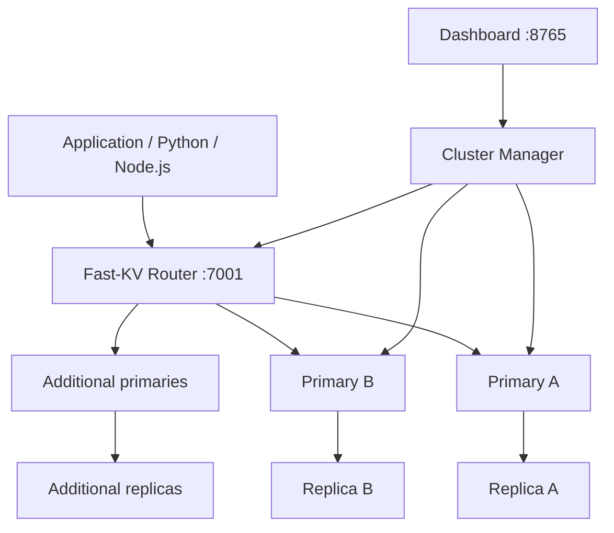

# Fast-KV

**Distributed in-memory caching engine built in C++.**

Fast-KV stores frequently accessed application data in memory and distributes keys across storage nodes. A cluster manager handles capacity-based scale-out, replication, and primary failover. Developers connect through one router endpoint, use Python or Node.js SDKs, and manage the cache through a web dashboard.

## Features

| Component | Capabilities |
| --- | --- |
| Cache engine | `SET`, `GET`, `DEL`, `EXISTS`, `INCR`, key expiration and LRU eviction |
| Cluster | Automatic scale-out at configurable memory thresholds, manual memory resize |
| Availability | Primary/replica synchronization and automatic primary promotion |
| Persistence | Append-only log and recovery after restart |
| Observability | Node health, throughput, latency, and request errors |
| Control plane | Cluster Control, Key Console, Key Browser, events and verified backups |
| Developer tooling | One-command launcher, Python SDK, Node.js SDK and terminal CLI |

## How it works



Applications use Fast-KV as a **cache-aside store**: read from Fast-KV first, load missing values from the primary database, and cache them with a TTL. On a source-data update, the application invalidates or refreshes the corresponding cache key.

## Get started

### Requirements

- macOS or Linux with a C++20 compiler and CMake 3.20+
- Python 3.9+ for the launcher and Python SDK
- Node.js 18+ if using the JavaScript SDK

Clone the repository, then run from its root:

```bash
bash scripts/install_local.sh
~/.local/bin/fastkv start
~/.local/bin/fastkv status
~/.local/bin/fastkv dashboard
```

The dashboard opens at **http://127.0.0.1:8765**. Applications connect to the router at **127.0.0.1:7001**.

For a custom cluster:

```bash
~/.local/bin/fastkv start --capacity-mb 128 --max-nodes 3 --threshold 70 --replicas 1
```

Stop the cache safely:

```bash
~/.local/bin/fastkv stop
~/.local/bin/fastkv shutdown
```

`stop` preserves data and leaves the dashboard running; `shutdown` also closes the launcher-managed dashboard. To use the shorter `fastkv` command, add `~/.local/bin` to your `PATH` as described in [installation](docs/easy_install.md).

## Python SDK

```bash
python3 -m venv .venv
source .venv/bin/activate
python -m pip install --no-cache-dir ./sdk/python
```

```python
from fastkv import FastKV

cache = FastKV(port=7001)
cache.set("product:101", "cached", ttl=300)
print(cache.get("product:101"))
cache.incr("requests")
cache.delete("product:101")
```

## Node.js SDK

From the repository root:

```js
const { FastKV } = require('./sdk/node');

async function main() {
  const cache = new FastKV();
  await cache.set('product:101', 'cached', { ttl: 300 });
  console.log(await cache.get('product:101'));
}

main().catch(console.error);
```

## Dashboard

The control plane presents features in workflow order:

1. **Overview and Monitoring** — cluster health and request metrics
2. **Cluster Nodes** — memory usage and replica status
3. **Cluster Control** — start/stop, capacity, scaling and key lifetime policy
4. **Key Console** — execute cache commands and inspect results
5. **Key Browser** — list, search, edit, and expire keys
6. **Events and Backups** — inspect recent activity and manage verified offline backups

## Tests

```bash
cmake -S . -B build-debug
cmake --build build-debug -j4
ctest --test-dir build-debug --output-on-failure
python3 tests/test_dashboard_layout.py
python3 tests/test_sdk_phase8.py
(cd sdk/node && npm test)
```

To run the launcher integration test, first stop the active cluster and dashboard:

```bash
python3 tests/test_easy_install.py ./build-debug/cluster-manager ./build-debug/fast-kv
```

More tests live in `tests/`; performance tools are in `benchmarks/`.

## Repository structure

```text
bin/             Local launcher
cluster/         Cluster manager and router
src/, include/   C++ engine, protocol, memory and persistence
sdk/python/      Python client and CLI
sdk/node/        Node.js client
dashboard/       Dashboard and backup management
examples/        Application caching examples
tests/           Unit and integration tests
benchmarks/      Benchmark tools
docs/            Setup and technical guidance
```

## Compatibility and security

Fast-KV uses a line-based command protocol with whitespace-free key/value tokens, rather than Redis RESP. The current default configuration binds to loopback and has no authentication or TLS; use network isolation if integrating it into a larger environment. Backups require the cluster to be stopped, and automatic scale-in is not included.

See [installation](docs/easy_install.md) and the [cache-aside example](examples/cache_aside.py) for usage details.
